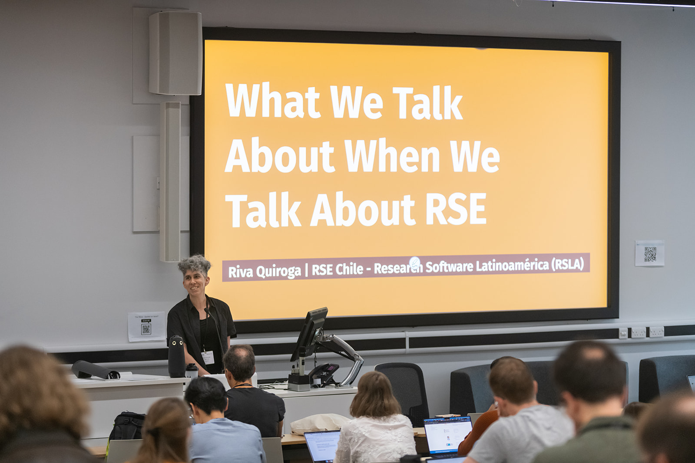
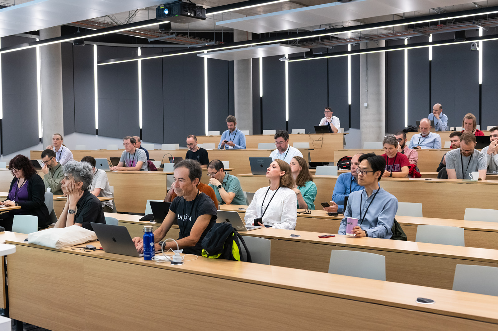
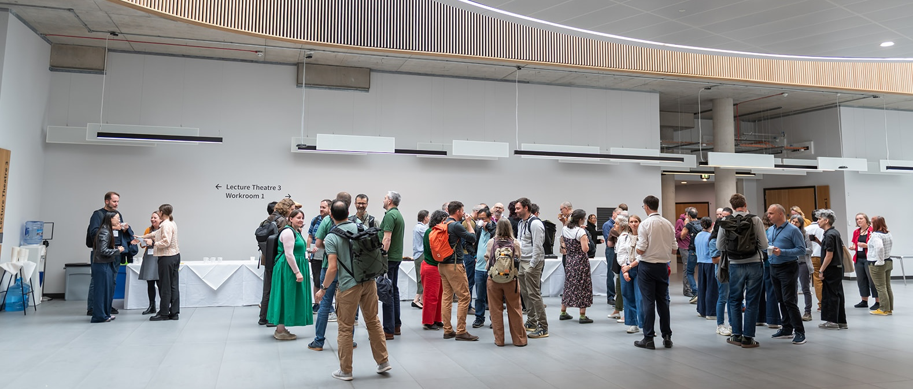
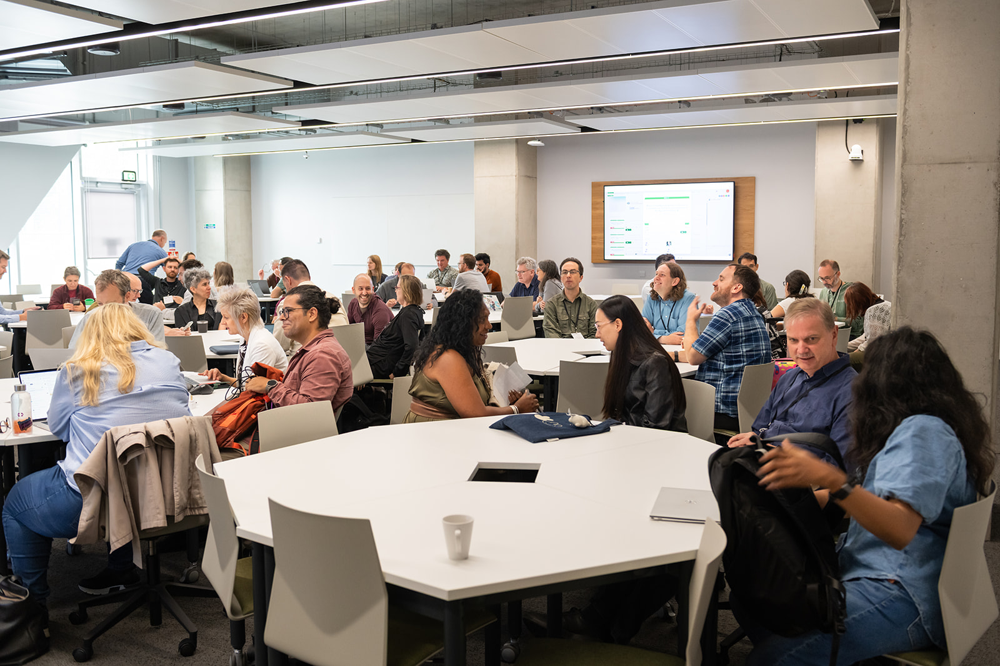
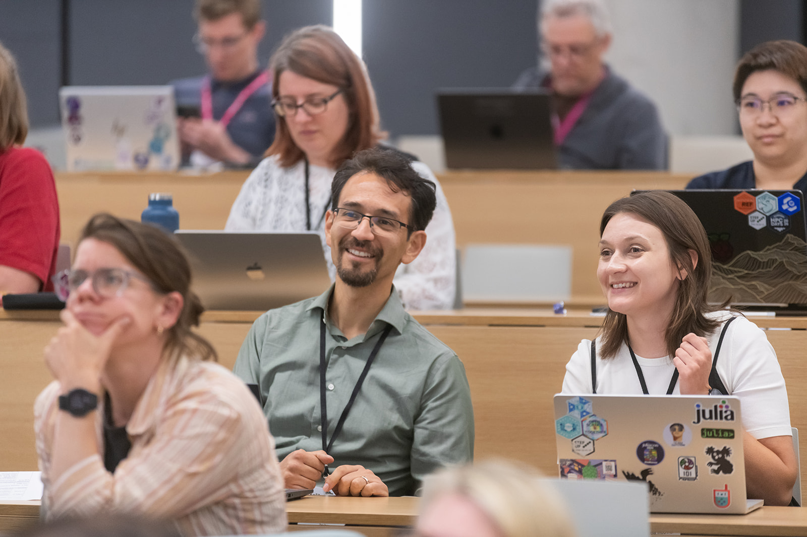

# Advancing Research Software Through Global Collaboration: Highlights from IRSC26

**Hero Image:**

- 

#### Contributed by [Michelle Barker](https://www.linkedin.com/in/michelledbarker) and Kim Hartley

#### Publication date: October 12, 2026

<!-- begin deck -->
The inaugural International Research Software Conference brought together more than 110 participants to explore how global collaboration can strengthen the sustainability, recognition, and impact of research software.
<!-- end deck -->

Research software sits behind an increasing share of modern research, but the systems needed to fund, maintain, recognize, govern, and develop it have not kept pace with its importance. Generative AI is adding new urgency. As producing code and other research outputs becomes easier, questions of trust, verification, provenance, maintenance, and long-term stewardship become even more important.

Addressing these challenges requires coordination not only among research software engineers, but also across the funders, publishers, policymakers, infrastructure providers, trainers, and research organizations that shape the wider research ecosystem.

These interconnected challenges provided the backdrop to the inaugural International Research Software Conference (IRSC). Held over two days in September 2026 and co-located with RSECon26 in Sheffield, UK, IRSC brought together more than 110 in-person and remote participants from across the international research software ecosystem. The program featured 20 talks, 10 lightning talks, 10 Birds of a Feather (BoF) sessions, and two plenary discussions.

 
Figure 1: IRSC26 participants gather for a session.
 

The conference created a dedicated space for communities to connect, exchange practices, and address shared challenges at the intersections of funding, publishing, policy, metascience, skills and training, and generative AI. A recurring message was that many of the challenges facing research software cannot be solved by individual projects or organizations: they require stronger coordination across the international research software community.

## IRSC highlights

### Funding

A BoF on evaluating research software funding, led by Neil Chue Hong (Institute for Research Software and University of Edinburgh) and Dario Taraborelli (Renaissance Philanthropy), explored approaches to understanding the effectiveness and impact of research software funding.

The conversation continued on the second day, with talks exploring lessons from the new multi-donor Open Source for Science Fund (OS4Science) and approaches to improving how research software funding is allocated. These discussions connect closely with the [Research Software Funders Forum](https://www.researchsoft.org/forums/), which brings funding organizations together to share practices, identify common challenges, and explore opportunities for greater coordination.

### Publishing

Lauren Cadwallader (PLOS) presented "Beyond Computational Biology: Making Code Sharing Policies Work Across Research Fields," exploring how approaches to code-sharing policies can be applied across research disciplines.

This was followed by a BoF on separating data and code in open science policies. The session introduced a new working group within the Publishing Research Software (PubSoft) Forum focused on improving publisher policies for sharing research software and code. The discussion also connected this work with related initiatives across the research software ecosystem, including the joint ReSA and Research Data Alliance working group on Policies in Research Organisations for Research Software (PRO4RS), and discussions with research funders on code policy.

 
Figure 2: Participants connect between IRSC26 sessions.
 

### Policy

The BoF "Committing to Sustainable Research Software with ADORE," led by Lieke de Boer (Netherlands Organisation for Health Research and Development), Marta Teperek (Dutch Research Council), and Carlos Martinez-Ortiz (Netherlands eScience Center), explored how organizations are putting the recommendations of the [Amsterdam Declaration on Funding Research Software Sustainability (ADORE)](https://adore.software/) into practice.

Examples from signatories, including the Digital Research Alliance of Canada, ELIXIR, and the German Research Foundation, demonstrated the different ways ADORE can support institutional change. Other sessions highlighted complementary approaches. In a lightning talk, Ishwar Chandramouliswaran (U.S. National Institutes of Health) described how the NIH Office of Data Science Strategy supports sustainable, open, and interoperable research software ecosystems through investments in best practices, workforce development, infrastructure, standards, and partnerships.

IRSC also highlighted efforts to translate shared principles into practical action. The BoF "From Principles to Practice: Driving Adoption of FAIR Research Software Across the Ecosystem" introduced step-by-step guidelines developed by ReSA's Actionable FAIR4RS task force to help translate the FAIR Principles for Research Software into practice. This work complements the broader activities of the [Research Software Policy Forum](https://www.researchsoft.org/forums/), which provides an ongoing space for policymakers to share practices and support greater coordination in policy development and implementation.

### Metascience

The Research Software Metascience BoF, led by Wilhelm Hasselbring (Kiel University), Daniel S. Katz (University of Illinois Urbana-Champaign), Rena Bakhshi (Netherlands Organisation for Applied Scientific Research), and Simon Hettrick (University of Southampton), brought participants together to consider research software through a metascience lens.

The session built on conversations taking place through the Metascience and Research Software (MaRS) Forum. This collaboration among metascience groups, communities, and organizations seeks to better understand the implications of research software for the research ecosystem and research process. The forum provides a space to identify gaps and opportunities, strengthen research software as an area of research, and increase awareness of research examining the role and impact of software across the research ecosystem.

### Skills and training

The BoF "International perspectives on sustainability challenges and opportunities in research software training networks," led by Eva Lekkerkerker, Fenne Riemslagh, Jeremy Cohen, and Danny Garside, explored how training networks can become more sustainable and scalable. These networks remain heavily dependent on individual trainers whose contributions are often under-recognized and difficult to sustain.

Samantha Wittke (CSC - IT Center for Science) shared a practical example through CodeRefinery's "bring your own classroom" model, which combines shared online teaching with local, community-led support. Mike Simpson (Society of Research Software Engineering) highlighted the Society's work to build community, strengthen recognition and career development for RSEs, and create opportunities for greater involvement in the RSE movement.

These themes are central to the [Skills and Training for Research Software (STaRS) Forum](https://www.researchsoft.org/forums/), which connects organizations and initiatives working to strengthen research software skills and training globally.

 
Figure 3: Small-group conversations supported collaboration across the conference.
 

## Generative AI and research software

Generative AI was a prominent theme throughout IRSC, with sessions exploring its implications for how research software is developed, maintained, evaluated, and sustained. In her welcome remarks, ReSA Director Michelle Barker highlighted how generative AI amplifies existing challenges for the research software community, particularly around trust, verification, maintenance, and stewardship.

As creating research outputs becomes easier and cheaper, greater investment is needed in the infrastructure and expertise required to verify and sustain them, as well as in the shared knowledge, software, and communities on which AI depends. Rather than simply consuming this shared commons, the research community must also sustain and reproduce it. The impact of generative AI is therefore not only a technological challenge, but also a collective-action problem.

Several talks and sessions built on discussions from ReSA and Schmidt Sciences' March 2026 workshop on research software engineering in the age of generative AI. The BoF "Research Software Engineering: Evolving Competencies, Practices and Interfaces in the Age of Generative AI" explored evolving RSE competencies, practices, training, and roles.

Other talks explored the practical implications of this shift. Joseph Shingleton (University of Glasgow) presented the Responsible AI Risk Register for RSE (RAIRR), a community resource for documenting AI risk. Arfon Smith (Schmidt Sciences) explored the evolving RSE role, including opportunities from AI-enabled workflows and interfaces, gaps in evaluation, provenance, and reproducibility, and new demands on software maintainers.

Carina Kemp (Amazon Web Services) shared practical lessons from AWS's AI-assisted development journey and explored how the research software community can establish shared standards, validation practices, and open tooling to ensure that AI augments rather than undermines research integrity.

Lois Curfman McInnes (Argonne National Laboratory) and Anshu Dubey (RIKEN Center for Computational Science) explored what is needed to build AI-ready scientific software ecosystems. They emphasized three priorities: making trust explicit, designing socio-technically, and investing in judgment. They also posed a broader question to the community: What should our communities build together that no single project or institution can accomplish alone?

A plenary discussion on sustaining research software under AI-assisted development considered how generative AI is changing code generation and the roles and expectations of different stakeholders in research software engineering. The discussion highlighted the importance of machine-readable provenance and careful human verification.

 
Figure 4: Participants listen to a presentation during IRSC26.
 

## Thank you to the IRSC community

The inaugural IRSC would not have been possible without the speakers, session chairs, remote facilitators, volunteers, Program Committee, RSECon26 organizers, and the ReSA and Institute for Research Software teams who contributed their time and expertise. The organizers also gratefully acknowledge the Alfred P. Sloan Foundation for supporting the scoping report that helped shape IRSC, as well as the initial committee members and stakeholders who helped inform and guide the process.

IRSC26 was also made possible through the support of its sponsors and partners: Amazon Web Services as Gold Sponsor; Schmidt Sciences as Silver Sponsor; the Netherlands eScience Center, NWO, the Society of Research Software Engineering, and the U.S. NIH Office of Data Science Strategy as Bronze Sponsors; and the Institute for Research Software and the National Center for Supercomputing Applications at the University of Illinois Urbana-Champaign as Partners.

## Looking ahead

IRSC highlighted the wide range of work taking place across the international research software community and the importance of greater coordination across these efforts.

By bringing these communities together, the conference created opportunities to strengthen connections, exchange approaches and experiences, and identify areas for future collaboration. The organizers invite the community to:

- Watch the [IRSC26 keynote recordings](https://www.researchsoft.org/irsc/) and explore the program.
- Join a ReSA forum or task force to contribute to ongoing discussions and collaborations.
- Subscribe to the [ReSA newsletter](https://www.researchsoft.org/) for updates and opportunities to get involved.

The organizers look forward to building on the momentum of IRSC and continuing to strengthen collaboration across the global research software community.

This article is being cross-posted by the [Research Software Alliance](https://www.researchsoft.org/blog/) (ReSA), [Better Scientific Software](https://bssw.io/), the [Institute for Research Software](https://www.software.ac.uk/), and the [Netherlands eScience Center](https://www.esciencecenter.nl/).

*Images: Dan Mogan Photography.*

## Author bios

[Michelle Barker](https://www.linkedin.com/in/michelledbarker/) is Director of the Research Software Alliance. She has extensive expertise in open science, the research software community, digital skills, and digital research infrastructure, and is passionate about building collaborative partnerships to achieve system change.

Kim Hartley is Program Manager at the Research Software Alliance, where she supports international collaboration and community engagement across the research software ecosystem.

<!---
Publish: yes
Track: Community
Pinned: no
Topics: conferences and workshops, research software engineers, software sustainability, projects and organizations, funding sources and programs
--->
