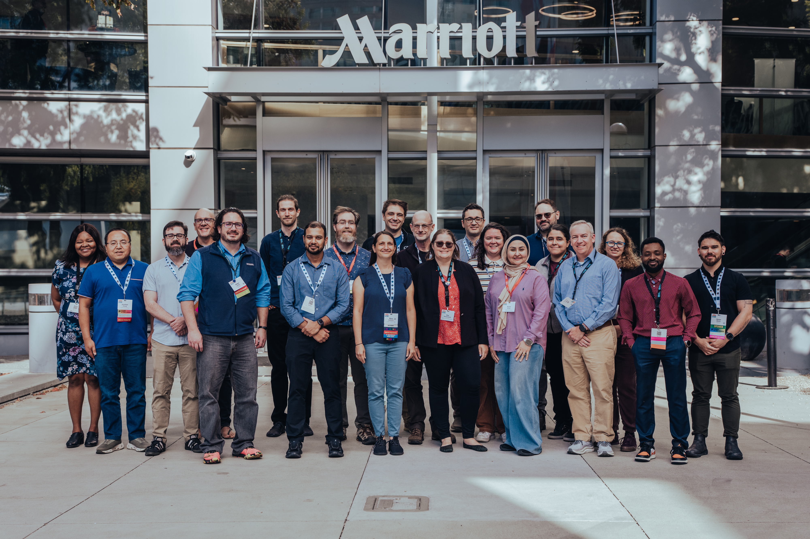

# The Better Scientific Software Fellowship at US-RSE'26

#### Contributed by [Adam Lavely](https://github.com/adamlavely)

#### Publication date: November 13, 2026

<!-- begin deck -->
The Better Scientific Software Fellowship at US-RSE'26!
<!-- end deck -->

The [Better Scientific Software (BSSw) Fellowship](https://bssw.io/fellowship) community was alive and well at the [US Research Software Engineer Association](https://us-rse.org) conference ([US-RSE'26](https://us-rse.org/usrse26/)), held in October in San Jose, California. Attendees enjoyed boba, a games night, and opportunities to learn about ongoing activities and establish future collaborations. The conference brought together talks, posters, and conversations focused on improving scientific computing. During the concluding plenary, Elsa Gonsiorowski, Coordinator of the BSSw Fellowship Program, highlighted our [2026 BSSw Fellows and Honorable Mentions](https://bssw.io/pages/meet-our-fellows). 

[BSSw Fellows and Honorable Mentions from various cohorts enjoyed attending US-RSE'26.]

The 2026 Fellow cohort made an immediate splash across the technical program. Victor Weeks and Parmanand Sinha contributed to a high-impact session on AI code modernization presenting their frameworks for reliable scientific agentic engineering and HPC translation patterns. Drew Paine explored practical applications of GenAI tools in scientific workflows and served as the conference Technical Program Co-Chair. Also representing the cohort, Mary Goldman co-led an interactive workshop on user experience journey mapping, while Jakob Bludau presented design patterns for portable, high-performance software.

Past fellows, Honorable Mentions, and program leaders also helped shape discussions about the evolving RSE landscape. Alejandra Castillo delivered a talk on preparing students for AI-assisted research, addressing the vital human element of future workforce development. Senior leaders and alumni from the inaugural 2018 class continued to shape foundational software practices: Jeff Carver co-led a hands-on workshop on threat modeling alongside sessions on RSE training bootcamps, and Dan Katz contributed to panels navigating generative AI risks and institutional collaborations. Program leaders also hosted a dedicated Birds of a Feather session connecting current and prospective applicants. These contributions highlighted the fellowship network’s role in advancing scientific software engineering across national labs, academia, and industry. 

I thank co-chairs Keith Beattie (HM, 2021) and Alex Koufos for their hard work in organizing US-RSE'26. The BSSw Fellowship community looks forward to US-RSE'27 in Ann Arbor, Michigan. We are excited to engage with you [there](https://us-rse.org/usrse27/)!

## Further information

* Check out the US-RSE [website](https://us-rse.org) and the US-RSE'26 [conference proceedings](https://zenodo.org/communities/usrse26/).  

## Author bio

Adam Lavely is the BSSw Fellowship Deputy Coordinator and a User Environment Architect at Lawrence Berkeley National Laboratory.

<!---
Publish: yes
Track: BSSw Fellowship
Pinned: no
Topics: Funding sources and programs, projects and organizations, conferences and workshops
OpenGraph image: OG_2508_BSSwFellowships.png
--->
