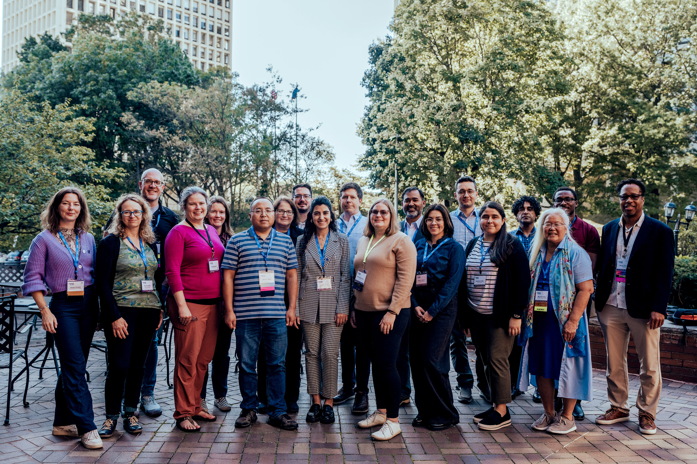

# The Better Scientific Software Fellowship at US-RSE'25

#### Contributed by [Adam Lavely](https://github.com/adamlavely)

#### Publication date: November 6, 2026

<!-- begin deck -->
The Better Scientific Software Fellowship at US-RSE'26!
<!-- end deck -->

The [Better Scientific Software (BSSw) Fellowship](https://bssw.io/fellowship) community was alive and well at the [US Research Software Engineer Association](https://us-rse.org) conference ([US-RSE'26](https://us-rse.org/usrse26/)), taking place in October in San Jose, California. There was wonderful boba, a fantastic games night, and great opportunities to learn about ongoing activities and to set up future collaborations. The conference was a wonderful time filled with talks, posters and interactions all leading towards better scientific computing, including the showcase of our [2026 BSSw Fellows and Honorable Mentions](https://bssw.io/pages/meet-our-fellows) during the concluding plenary session by Elsa Gonsiorowski, Coordinator of the BSSw Fellowship Program. 

[BSSw Fellows and Honorable Mentions from various cohorts enjoyed attending US-RSE'25.]

The 2026 Fellow cohort made an immediate splash across the technical program. Victor Weeks and Parmanand Sinha contribured to a high-impact session on AI code modernization presenting their frameworks for reliable scientific agentic engineering and HPC translation patterns. Drew Paine explored practical applications of GenAI tools in scientific workflows alongside serving as the conference Technical Program Co-Chair. Adding to the cohort’s broad reach, Mary Goldman co-led an interactive workshop guiding attendees through user experience journey mapping, while Jakob Bludau presented design patterns for portable, high-performance software.

Beyond the newest class, the broader BSSw community, spanning past fellows, honorable mentions, and program leaders, helped steer critical discussions on the evolving RSE landscape. Alejandra Castillo delivered a talk on preparing students for AI-assisted research, addressing the vital human element of future workforce development. Senior leaders and alumni from the inaugural 2018 class continued to shape foundational software practices: Jeff Carver co-led a hands-on workshop on threat modeling alongside sessions on RSE training bootcamps, and Dan Katz contributed to panels navigating generative AI risks and institutional collaborations. Together with program leadership who hosted a dedicated Birds of a Feather session connecting current and prospective applicants, the fellowship network demonstrated its central role in advancing scientific software engineering practices across national labs, academia, and industry. 

The US-RSE'26 conference was wonderful, and I wish to thank both Keith Beattie (HM, 2021) and Alex Koufos, the co-chairs whose incredibly hard work made for a fantastic time for attendees. The BSSw Fellowship community looks forward to the US-RSE’27 conference, to be held in beautiful Ann Arbor, Michigan. We are excited to engage with you [there](https://us-rse.org/usrse27/)!

## Further information

* Check out the US-RSE website: [https://us-rse.org](https://us-rse.org).  

## Author bio

Adam Lavely is the BSSw Fellowship Deputy Coordinator and a User Environment Architect at Lawrence Berkeley National Laboratory.

<!---
Publish: yes
Track: BSSw Fellowship
Pinned: no
Topics: Funding sources and programs, projects and organizations, conferences and workshops
RSS update: 2025-12-16
OpenGraph image: OG_2508_BSSwFellowships.png
--->
